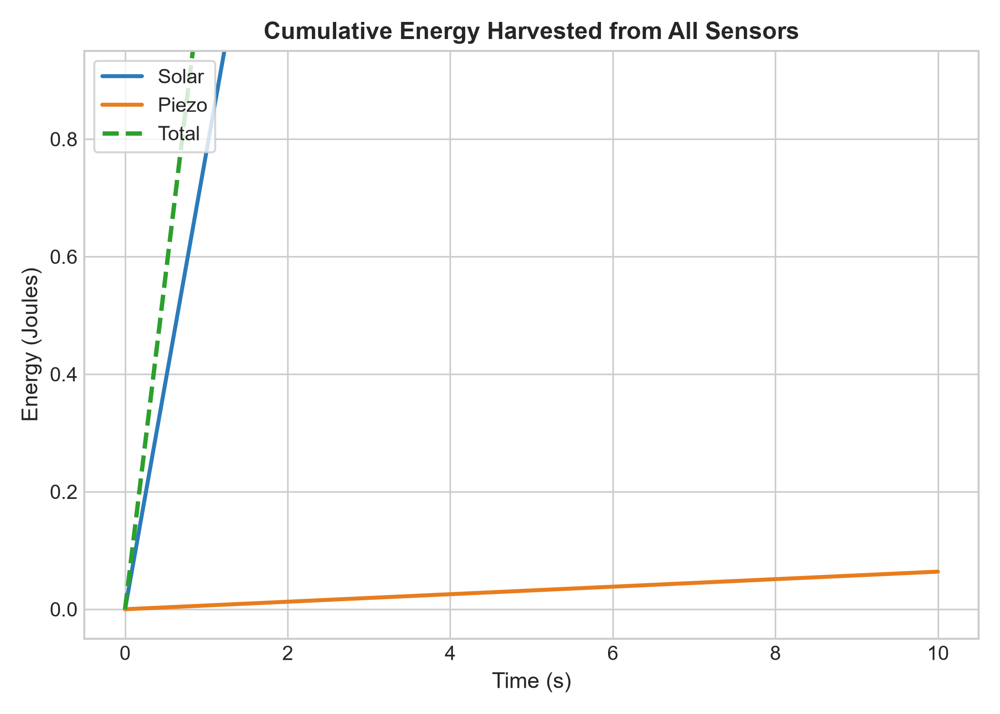
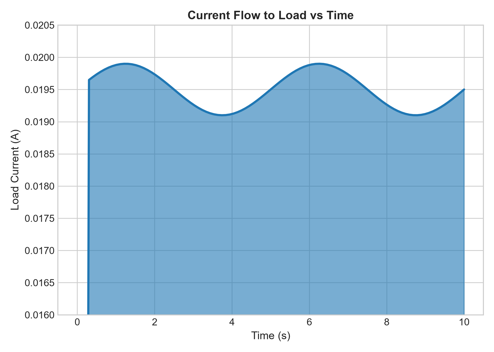
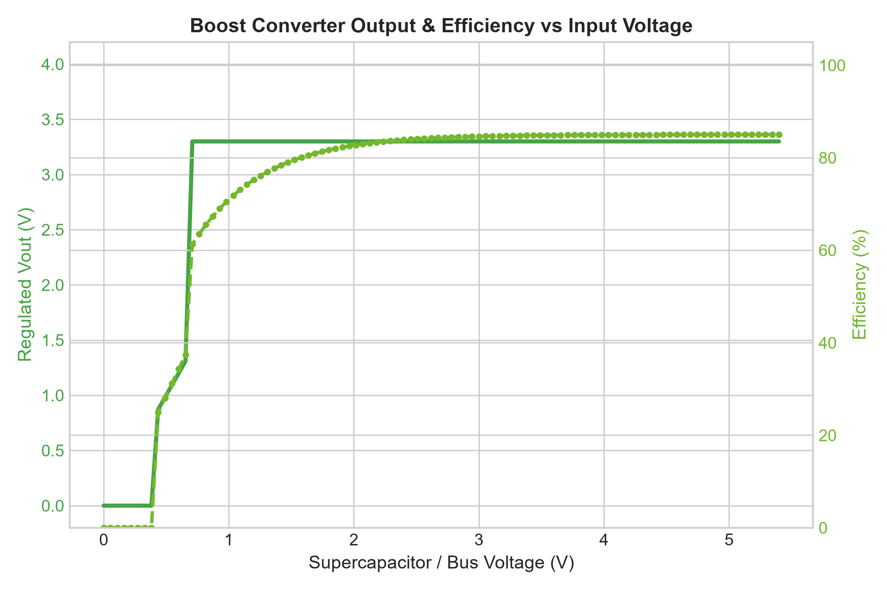
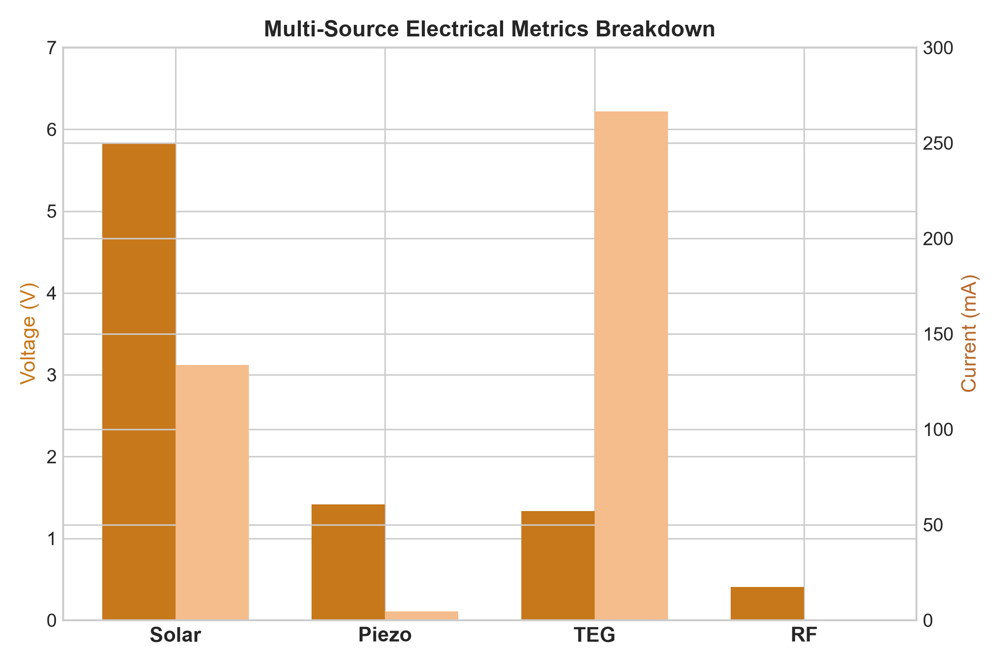

<div align="center">

# Omni-Harvester
### Universal Hybrid Multi-Source Energy Harvesting System for Autonomous IoT Applications

[](https://github.com/affrin-19/omni-harvester)
[](https://opensource.org/licenses/MIT)
[](https://isocpp.org/)
[](https://www.python.org/)
[](https://platformio.org/)
[](https://github.com/affrin-19/omni-harvester/actions)

**A unified, multi-modal ambient energy harvesting architecture combining Solar, Piezoelectric, Thermoelectric (TEG), and Ambient Radio-Frequency (RF) sources to deliver uninterrupted, battery-less power for low-power edge IoT devices.**

[System Architecture](#system-architecture) · [Circuit Schematic](#circuit-schematic) · [Physical Modeling & Simulation](#physical-modeling--simulation) · [Interactive Lab](#interactive-web-simulation) · [Bill of Materials](#bill-of-materials) · [Firmware](#firmware-and-power-management) · [Publications](#publications-and-citation)

</div>

---

## Executive Summary

Traditional wireless sensor networks (WSNs) and edge Internet of Things (IoT) nodes rely on chemical batteries that suffer from finite operational lifespans, periodic manual maintenance overhead, and environmental toxicity. While single-source energy harvesting (e.g., solar-only) offers partial autonomy, it is fundamentally vulnerable to environmental intermittency (e.g., complete solar inactivity at night or in shaded indoor settings).

**Omni-Harvester** addresses single-point energy starvation by integrating four orthogonal ambient energy domains into a singular, low-loss, self-starting power management unit (PMU):
1. **Solar Photovoltaic**: High power density under ambient natural or artificial light.
2. **Piezoelectric Vibration**: Mechanical kinetic scavenging from structural vibrations, machinery, and transit.
3. **Thermoelectric (TEG)**: Thermal gradient harvesting via the Seebeck effect across industrial surfaces.
4. **Ambient RF**: Electromagnetic energy capture from ubiquitous Wi-Fi (2.4 GHz) and cellular networks.

A low forward-voltage Schottky diode-OR architecture concurrently pools charge into a central $1.0\text{ F} \text{ / } 5.5\text{V}$ Electric Double Layer Capacitor (EDLC) buffer. A high-efficiency synchronous boost regulator then steps the variable DC bus up to a stable $3.3\text{V}$ rail, driving an ultra-low-power microcontroller managed by an energy-aware adaptive duty-cycling algorithm.

---

## System Architecture

```
┌──────────────────────────────────────────────────────────────────────────┐
│                            Ambient Energy Inputs                         │
├───────────────┬───────────────────┬───────────────────┬──────────────────┤
│  Solar PV     │  Piezo Array      │  Seebeck TEG      │  Ambient RF      │
│  (6V, 1W)     │  (8x 35mm PZT)    │  (TEC1-12706)     │  (Multiband)     │
└───────┬───────┴─────────┬─────────┴─────────┬─────────┴────────┬─────────┘
        │ DC              │ AC                │ DC Low-V         │ RF Wave
        ▼                 ▼                   ▼                  ▼
┌───────────────┐ ┌───────────────┐ ┌───────────────────┐ ┌────────────────┐
│ Direct DC     │ │ Full-Bridge   │ │ Ultra-Low V Boost │ │ Villard Multi- │
│ Pass-Through  │ │ Rect (DF02M)  │ │ Input Stage       │ │ plier Ladder   │
└───────┬───────┘ └───────┬───────┘ └─────────┬─────────┘ └────────┬───────┘
        │                 │                   │                    │
     D1 ▼ (1N5819)     D2 ▼ (1N5819)       D3 ▼ (1N5819)        D4 ▼ (1N5819)
        └─────────────────┴─────────┬─────────┴────────────────────┘
                                    │
                                    ▼
┌──────────────────────────────────────────────────────────────────────────┐
│                         Central Storage Matrix                           │
│  ┌───────────────────────────────┐   ┌────────────────────────────────┐  │
│  │ Electrolytic Filter (1000uF)  │   │ EDLC Supercapacitor (1.0F/5.5V)│  │
│  │ Transient surge suppression   │   │ Long-term blackout buffer      │  │
│  └───────────────────────────────┘   └────────────────────────────────┘  │
└───────────────────────────────────┬──────────────────────────────────────┘
                                    │ DC Bus: 1.0V – 5.5V
                                    ▼
┌──────────────────────────────────────────────────────────────────────────┐
│                   Synchronous Boost Regulator (TPS610981)                │
│             V_start = 0.70V  │  Quiescent Current < 350nA  │  η ≈ 85%    │
└───────────────────────────────────┬──────────────────────────────────────┘
                                    │ Regulated 3.3V DC Rail
                                    ▼
┌──────────────────────────────────────────────────────────────────────────┐
│              Autonomous IoT Load (ESP32-PICO / MSP430)                   │
│   Power Manager State Machine: Deep Sleep (5uA) ──> Sensing ──> RF Tx   │
└──────────────────────────────────────────────────────────────────────────┘
```

---

## Ambient Harvesting Modalities

| Harvesting Domain | Transducer / Component | Ambient Stimulus | Typical Open-Circuit Voltage | Typical Current Range | Conditioning Circuitry |
| :--- | :--- | :--- | :---: | :---: | :--- |
| **Solar PV** | Monocrystalline 6V/1W Panel | Sunlight / Indoor Lighting | $4.50\text{V} - 6.00\text{V}$ | $10\text{mA} - 167\text{mA}$ | Diode isolated direct feed |
| **Piezoelectric** | $8\times 35\text{mm}$ PZT Disc Array | Mechanical vibration ($30\text{-}100\text{Hz}$) | $2.50\text{V} - 5.00\text{V}$ (Peak) | $0.8\text{mA} - 2.5\text{mA}$ | Full-wave bridge rectifier (DF02M) |
| **Thermoelectric** | TEC1-12706 Bismuth Telluride | Temperature delta ($\Delta T = 10\text{–}60^\circ\text{C}$) | $0.40\text{V} - 1.80\text{V}$ | $20\text{mA} - 250\text{mA}$ | Impedance-matched direct DC feed |
| **Ambient RF** | Multiband Patch Antenna | Wi-Fi ($2.4\text{GHz}$) / Cellular ($850\text{MHz}$) | $0.15\text{V} - 0.45\text{V}$ | $10\ \mu\text{A} - 150\ \mu\text{A}$ | 4-stage Villard voltage multiplier |

---

## Circuit Schematic

The core combining network employs a parallel diode-OR topology utilizing ultra-low forward-voltage Schottky barrier diodes ($1\text{N}5819$):

```
                   D1 (1N5819)
    Solar (+)  ───────|>|───────┐
    (6V, 1W)                   │
                                │
                   D2 (1N5819)  │
    TEG (+)    ───────|>|───────┼──────────┬──────────────┐
    (0.5V)                      │          │              │
                                │        + │              │
                   D3 (1N5819)  │       ┌─────┐       ┌────────┐
    RF Multiplier ────|>|───────┤       │ C1  │       │ C_SUP  │
    (0.3V)                      │       │1000u│       │ 1.0F   │
                                │       │ 16V │       │  5.5V  │
    Piezo Array                 │       └─────┘       └────────┘
    (VSINE)                     │          │ -            │
        │                       │          │              │
     [Bridge]      D4 (1N5819)  │          │              │
     (DF02M) ─────────|>|───────┘          │              │
        │                                  │              │
        └──────────────────────────────────┴──────────────┘
                                           │
                                           ▼ DC Bus (1.0V - 5.5V)
                                    ┌──────────────┐
                                    │ Boost Conv.  │
                                    │ (TPS610981)  │
                                    └──────┬───────┘
                                           │
                                           ▼ Regulated 3.3V
                                    ┌──────────────┐
                                    │ IoT MCU Load │
                                    └──────────────┘
```

The SPICE circuit netlist is available in [`hardware/schematics/omni_harvester.cir`](hardware/schematics/omni_harvester.cir).

---

## Experimental Results and Physical Benchmarks

The physical mathematical model simulates transient multi-source combining dynamics, supercapacitor charging rates, and boost converter efficiency curves.

### 1. Cumulative Energy Harvested vs. Time
Demonstrates energy accumulation over time under typical operating parameters (Solar: 80%, Vibration: 40%, $\Delta T = 31^\circ\text{C}$, RF: 81%). While single sources exhibit low individual yields, the concurrent multi-modal integration achieves linear, sustained energy accumulation exceeding $0.85\text{ Joules}$ in $10\text{ seconds}$.



### 2. Current Flow to Load vs. Time
Demonstrates constant, regulated current delivery to the active IoT load ($I_{load} \approx 19.5\text{mA} - 20.0\text{mA}$) supported by the supercapacitor reserve without voltage collapse.



### 3. Boost Output Voltage & Power Efficiency
Illustrates the regulated $3.3\text{V}$ output rail and efficiency curve $\eta(V_{bus})$ of the synchronous boost stage across varying supercapacitor voltages ($0.0\text{V}$ to $5.4\text{V}$), reaching a stable peak efficiency of $85\%$.



### 4. Multi-Source Electrical Metrics Breakdown
Bar graph depicting instantaneous voltages and currents delivered across individual harvesting stages.



---

## Interactive Web Simulation

An interactive HTML5/Canvas simulation is provided in [`web-simulation/index.html`](web-simulation/index.html).

To run locally:
```bash
# Open directly in any modern browser
start web-simulation/index.html
```

It features live sliders for:
- **Solar Irradiance** ($0 - 100\%$)
- **Vibration Intensity** ($0 - 100\%$)
- **Temperature Gradient ($\Delta T$)** ($0 - 60^\circ\text{C}$)
- **RF Field Strength** ($0 - 100\%$)

Providing real-time calculated metrics for DC bus potential, total injected current, boost regulation status, and autonomous MCU operational feasibility.

---

## Bill of Materials (BOM)

| Item | Reference | Component Name | Key Specification | Package | Qty |
| :---: | :--- | :--- | :--- | :--- | :---: |
| 1 | **PV1** | Monocrystalline Solar Panel | $V_{oc} = 6.0\text{V}, I_{sc} = 167\text{mA}, 1\text{W}$ | $110\times 60\text{mm}$ Module | 1 |
| 2 | **PZ1–PZ8** | Piezoelectric PZT Disc Array | $35\text{mm}$ Brass, Resonant freq $2.9\text{kHz}$ | Disc Array | 8 |
| 3 | **TEG1** | Thermoelectric Module | Bismuth Telluride (TEC1-12706), $\Delta T = 10\text{–}60^\circ\text{C}$ | $40\times 40\text{mm}$ Ceramic | 1 |
| 4 | **ANT1** | Multiband RF Patch Antenna | $850\text{MHz} / 2.4\text{GHz}$, Gain $+3\text{dBi}$ | PCB Patch | 1 |
| 5 | **BR1** | Full-Wave Bridge Rectifier | DF02M, $V_{RRM} = 100\text{V}$ | DIP-4 / SMD-4 | 1 |
| 6 | **D1–D4** | Low-$V_F$ Schottky Diodes | 1N5819, $V_F \approx 0.28\text{V} @ 10\text{mA}, V_R = 40\text{V}$ | DO-41 | 4 |
| 7 | **C1** | Smoothing Filter Capacitor | Low-ESR Electrolytic, $1000\ \mu\text{F} / 16\text{V}$ | Radial $10\times 12.5\text{mm}$ | 1 |
| 8 | **C_SUPER** | Central EDLC Supercapacitor | $1.0\text{ Farad} / 5.5\text{V}$, Low self-discharge | Radial Coin | 1 |
| 9 | **U1** | Synchronous Boost Regulator | TI TPS610981 / LTC3105, $V_{in,min} = 0.70\text{V}$ | WSON-6 / DFN-10 | 1 |
| 10 | **U2** | Ultra-Low Power MCU | ESP32-PICO / MSP430FR5969, $I_{sleep} = 5\ \mu\text{A}$ | QFN-48 | 1 |

For complete manufacturer part numbers and procurement details, see [`hardware/bom/BOM.md`](hardware/bom/BOM.md).

---

## Firmware and Power Management

The embedded firmware ([`firmware/src/main.cpp`](firmware/src/main.cpp)) implements an energy-aware finite state machine (FSM):

```
       V_cap < 2.0V
    ┌────────────────┐
    │ STATE_CRITICAL │ ─── Deep Sleep (60s timer), Peripherals unpowered
    └───────┬────────┘
            │ V_cap >= 2.0V
            ▼
    ┌────────────────┐
    │ STATE_CHARGING │ ─── Light Sleep (20s timer), Internal clocks idling
    └───────┬────────┘
            │ V_cap >= 3.0V
            ▼
    ┌────────────────┐
    │ STATE_SENSING  │ ─── Wake (20ms), Read analog telemetry & environmental sensors
    └───────┬────────┘
            │ V_cap >= 3.8V
            ▼
    ┌────────────────┐
    │ STATE_BURST_TX │ ─── Full Operation (80ms), BLE/LoRa wireless burst transmission
    └────────────────┘
```

Build and flash using PlatformIO:
```bash
cd firmware
pio run --target upload
```

---

## Verification and Simulation

Run the automated simulation test suite using Python:

```bash
# Install dependencies
pip install -r simulation/requirements.txt

# Execute test suite
pytest tests/ -v

# Generate all benchmark plots
python simulation/plot_results.py
```

---

## Authors

| Name | Email | Role |
| :--- | :--- | :--- |
| **S. Affrin Wills** | affrinwills@gmail.com | Lead Hardware Engineer / Embedded Researcher |
| **M. Abishek** | sai248627@gmail.com | Circuit Design & Power Management |
| **G. S. Ajay Adithya** | ajayadhithyag@gmail.com | Physical Modeling & Embedded Firmware |

---

## Publications and Citation

If you utilize this architecture, circuit topologies, or simulation models in academic research or industrial implementations, please cite:

```bibtex
@INPROCEEDINGS{omni_harvester_2024,
  author={Wills, S. Affrin and Abishek, M. and Ajay Adithya, G. S.},
  title={Omni-Harvester: A Universal Hybrid Energy Harvesting System for IoT Applications},
  booktitle={Proceedings of International Conference on Energy Harvesting and Embedded Systems},
  year={2024}
}
```

---

## License

This project is licensed under the [MIT License](LICENSE) — open for academic, personal, and commercial engineering development.
